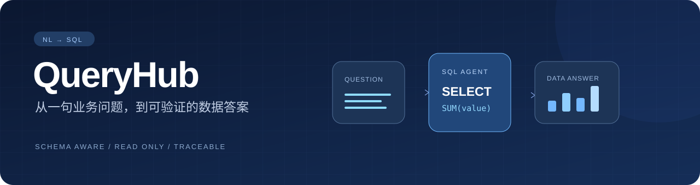
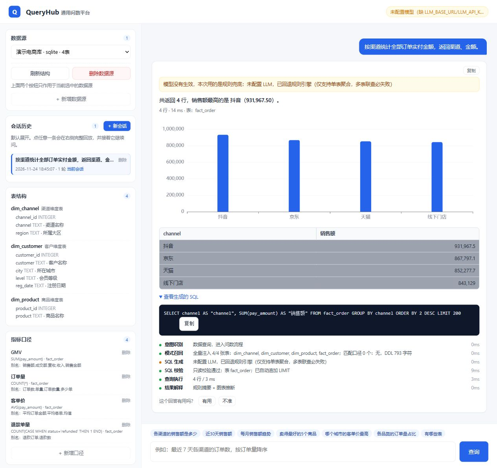
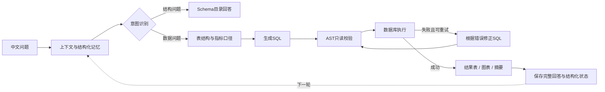

<div align="center">



# QueryHub · 自然语言问数 Agent

**用中文连接业务问题与数据库，让每个答案都有 SQL、有结果、有执行轨迹。**


[界面预览](#界面预览) · [工作原理](#工作原理) · [快速启动](#快速启动) · [评测与结果](#评测与结果) · [技术文档](docs/CONFIGURATION.md)

</div>

QueryHub 是一个面向结构化数据分析的 NL2SQL 展示项目。接入数据库后，系统读取表结构与业务口径，将中文问题转换为只读 SQL，并返回数据表、图表、摘要与完整执行轨迹。支持多轮追问、执行失败自修和结果导出。

## 界面预览



*使用独立生成的合成电商数据截图，演示规则模式的查询与可视化；截图不包含个人数据库、模型密钥或原有会话。复杂联查需配置模型。*

## 可以做什么

| 能力 | 实现方式 | 示例 |
|---|---|---|
| 中文问数 | 结构自省 + 模型生成 + SQL 执行 | “2026年10月各渠道销售额是多少？” |
| 业务口径 | 指标名称、别名、聚合公式与主表绑定 | GMV、订单量、客单价、退款单量 |
| 多轮修改 | 实际查询状态 + 近期对话 + 相关早期轮次 | “只看已完成订单”“时间换成9月” |
| SQL 护栏 | AST解析、单语句、只读、表白名单 | 拦截写操作及系统库访问 |
| 执行自修 | 将错误与上次SQL交回生成节点，最多重试两次 | 修复字段或方言错误 |
| 结果可追溯 | 展示 SQL、节点轨迹、行数、告警和耗时 | 定位生成、校验或执行阶段的问题 |
| 图表与导出 | ECharts + CSV流式输出 | 页面限量展示，完整结果按配置导出 |
| 无模型体验 | 自动退回单表规则引擎并展示告警 | 本地快速验证问数链路 |

## 工作原理



### 几个关键设计

- **用统一 Catalog 对接数据库。** SQLAlchemy 读取表、字段、注释、主外键；SQLite 使用 `_schema_notes` 补充中文语义。生成与校验均按数据源方言处理。
- **把业务口径交给系统维护。** 指标公式随相关表结构一起提供给模型，降低“字段选对、业务含义算错”的概率。
- **控制上下文而保留原始记录。** 服务端保存完整轮次；提示词组合结构化状态卡、近期原文和相关历史片段。按数据源隔离会话。
- **小库全量、大库召回。** 默认1000张表以内注入完整结构，超过阈值按相关度召回；轨迹记录表数和DDL字符数，便于分析上下文开销。
- **分别衡量执行与语义。** 评分比较实际结果和标准SQL执行结果，检查空值、重复行、排序和数值误差，不用SQL文本匹配代替语义验证。

## 快速启动

需要 Python 3.11+、Node.js 20.19+ 或 22.12+。以下命令在项目根目录运行。无需模型即可体验规则模式。

```bash
# 1. 安装 SQLite 演示所需后端依赖
python -m pip install -r backend/requirements-core.txt

# 2. 安装并构建前端
npm --prefix frontend ci
npm --prefix frontend run build

# 3. 生成合成演示库并注册数据源
python backend/scripts/seed_demo.py

# 4. 启动（保持运行）
python -m uvicorn app.main:app --app-dir backend --host 127.0.0.1 --port 8765
```

打开 **http://127.0.0.1:8765**，选择“演示电商库”，尝试：

> 按渠道统计全部订单实付金额，返回渠道、金额。
>
> 2026年10月订单数是多少？
>
> 有哪些表？

Windows 也可在完成前端构建后，进入 `backend` 运行 `.\run.ps1`。开发前端时使用 `npm --prefix frontend run dev`；后端需运行在8765端口以匹配Vite代理。

### 配置模型

把 `backend/.env.example` 复制为 `backend/.env`，填写 OpenAI 兼容端点、密钥和模型名称，然后重启后端。示例为本地 Ollama；也可改用自己的云端模型。

```dotenv
LLM_BASE_URL=http://127.0.0.1:11434/v1
LLM_API_KEY=ollama
LLM_MODEL=qwen2.5:7b
```

端点不要包含 `/chat/completions` 后缀。点击页面模型角标可实际测试连通性；三项配置齐全仅代表已配置。模型调用失败时，回答卡片会显示规则降级提示。

接入 MySQL、PostgreSQL、SQL Server、Oracle 等数据源需要安装相应驱动，见[配置与接口文档](docs/CONFIGURATION.md)。本仓库的自动结果评测使用 SQLite，其他数据库的实际兼容性需单独验证。

## 评测与结果

### 题集构成

**104条自动用例 = 92道问数题 + 12条SQL护栏检查**，另有[12项人工验收](backend/eval/MANUAL_CASES.md)。

| 范围 | 用例数 | 重点 |
|---|---:|---|
| 电商 / SaaS / 物流 / 银行 / 医院 / 教育 / 制造 | 70 | 每域5题，在A/B两份不同种子的合成数据上复测 |
| 150表宽库 | 4 | 大Schema选表、干扰表、分别聚合后关联 |
| 演示电商 | 12 | 基础聚合、指标、枚举、日期、空结果与NULL |
| 连续对话 | 6 | 过滤继承、时间替换、主题切换、历史引用、移除LIMIT |
| SQL护栏 | 12 | 9条危险拒绝 + 3条合法放行 |

完整[题目与标准SQL](backend/eval/CASES.md)、[机器可读题集](backend/eval/questions.jsonl)、[评分标准](backend/eval/README.md)均可查看。A/B是同题异数据复测；公开答案的holdout不等同于严格盲测。

### 首轮模型评测

以下为已完成的一次本地运行，发布时仅导出[脱敏汇总](docs/evaluation-summary.json)。模型供应商、个人端点和完整响应未公开；这些结果用于展示评测与诊断流程，不作为跨模型排行榜结论。

| 指标 | 结果 |
|---|---:|
| 查询执行成功 | 92 / 92 · **100%** |
| 查询结果一致 | 82 / 92 · **89.13%** |
| 护栏检查 | 12 / 12 |
| 规则降级 | 0% |
| 响应耗时 P50 / P95 | 7.63秒 / 19.00秒 |
| 多轮逐轮结果一致 | 6 / 6 |
| 多轮全部断言通过 | 0 / 1段会话 |

**保留失败，说明原因。** 10道结果不一致题均出现额外的“最近30天”过滤；当前提示词有此默认规则，部分题目的全时间标准与其冲突，需要统一产品口径后再评测。多轮查询结果均正确，但主题切换轮仍标记继承上下文，因此整段会话断言未通过。这是首轮原始结果，不是最终验收成绩。

### 本地复现

仓库不包含本地数据库、会话或原始评测日志。先通过固定种子生成15个合成测试库（默认约290万行，磁盘约246MB）：

```bash
python backend/scripts/generate_testdata.py --scale 0.8

# 验证标准SQL与护栏；不会调用模型
python backend/scripts/eval_run.py --mode validate

# 模型评测：使用自己的模型配置，会产生真实调用
python backend/scripts/eval_run.py --mode llm --output backend/eval/results/llm_run1.json

# 评分器回归测试
python -m unittest discover -s backend/eval -p test_eval_runner.py
```

`seed_demo.py` 与 `generate_testdata.py` 会重建对应合成库，请在独立演示数据目录使用；报告默认保存在被Git忽略的 `backend/eval/results/`。更换模型、数据或口径后请重新运行，不直接复用上表成绩。

## 项目结构

```text
backend/
  app/
    api/              # FastAPI路由
    services/         # 数据源、问数、会话、指标与导出
    agent/            # 意图、召回、生成、护栏、自修、上下文与记忆
    db/               # 引擎、自省、执行器与平台元数据
    llm/              # 模型客户端与提示词
  scripts/            # 合成数据生成、评测运行器
  eval/               # 标准题集、评分规则与评分器测试
frontend/
  src/components/     # 数据源、Schema、指标、会话、图表与答案卡片
docs/
  assets/             # 展示图片
  CONFIGURATION.md    # 配置与接口说明
  evaluation-summary.json
```

## 当前边界与后续工作

- 当前版本用于本地展示；尚未提供用户认证、多租户授权和凭据加密管理，不应直接暴露为公网数据库访问服务。
- SQL护栏是应用侧校验，数据库应另设只读账号；应用执行层尚无数据库侧查询超时，评测器另设SQLite进度中断。
- 空结果自动放宽可能改变明确筛选条件；需与时间默认规则一起完善并做回归。
- 宽Schema全量注入可能消耗较多上下文；当前未实现完整的列裁剪与二次召回策略。
- 后续重点：统一时间口径、完善主题切换、增加核心流水线测试，并完成跨库隔离及导出人工验收。

## 数据与发布说明

本项目展示数据由脚本合成。Git提交排除 `.env`、SQLite数据库、平台日志与会话、CSV导出、完整评测响应、依赖目录和构建产物。仅提交可复现源码、固定题集、脱敏汇总与独立合成数据截图。发布检查方法见[发布说明](docs/PUBLISHING.md)。
